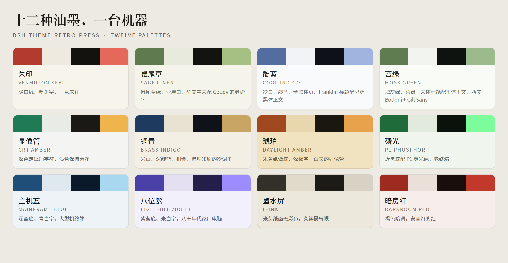
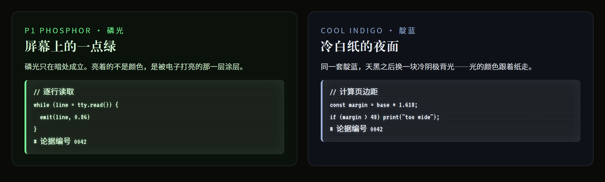

# Retro Press

Twelve palettes for the DeepSeek Harness Web client — a print shop and a row of old screens in the same drawer.



---

## 这是什么

Retro Press 是一间开在 DeepSeek Harness 里的复古印制车间。十二套配色，从木刻朱印的暖白纸，到显像管的磷光绿——每一套都有自己的纸、自己的规则线、自己的字体配对，还有一枚按该套配色重绘的 DeepSeek 鲸鱼标记。

它不做"换个颜色"这件事。每套配色是一份完整的排印决定：正文用宋还是用黑，标题要不要让浏览器合成加粗，引文该不该换成仿宋，代码块该不该像终端。同一套排在浅色下是纸，在深色下是屏幕——两副面孔，同一份稿。

十二套共用一条命名与质感规则，所以并排看是一抽屉的版，而不是十二个互相不认识的皮肤。

## Twelve palettes

| | 配色 | Palette | 纸与墨 |
|---|---|---|---|
| 1 | 朱印 | Vermilion seal | 暖白纸、墨黑字，一点朱红 |
| 2 | 鼠尾草 | Sage linen | 鼠尾草绿、亚麻白，华文中宋配 Goudy 的老铅字 |
| 3 | 靛蓝 | Cool indigo | 冷白、靛蓝，全黑体页：Franklin 标题配思源黑体正文 |
| 4 | 苔绿 | Moss green | 浅灰绿、苔绿，宋体标题配黑体正文，Bodoni 配 Gill Sans |
| 5 | 显像管 | CRT amber | 深色走琥珀字符，浅色保持素净 |
| 6 | 铜青 | Brass indigo | 米白、深靛蓝、铜金，港埠印刷的冷调子 |
| 7 | 琥珀 | Daylight amber | 米黄纸做底、深褐字，白天的显像管 |
| 8 | 磷光 | P1 phosphor | 近黑底配 P1 荧光绿，老终端 |
| 9 | 主机蓝 | Mainframe blue | 深蓝底、青白字，大型机终端 |
| 10 | 八位紫 | Eight-bit violet | 紫蓝底、米白字，八十年代家用电脑 |
| 11 | 墨水屏 | E-ink | 米灰纸面无彩色，久读最省眼 |
| 12 | 暗房红 | Darkroom red | 褐色暗调，安全灯的红 |

## 质感

配色定基调，下面每一项定质感，设置页里逐项切换，改动立即生效：

- **底纹** —— 纸纹像旧纸，扫描线像老显示器。
- **形状** —— 圆润，或把卡片与按钮的圆角收成直角。
- **字体** —— 随配色，或强制衬线 / 标题衬线 / 等宽。
- **线条** —— 细线，或印刷的双细线（分隔线、表格、引用一起换）。
- **密度** —— 标准，或收紧段间距与列表间距。
- **荧光** —— 只在深色模式：代码块带一层磷光与扫描线，像亮着的屏幕；浅色模式始终是纸。
- **动效** —— 印章呼吸闪烁；系统开了"减弱动效"时自动停。
- **品牌标记** —— 每套配色按自己的风格重绘鲸鱼标记，或退回原生图标。

深色模式下的磷光层：



## 字体

主题只**引用**字体名，不打包、不分发任何字体文件。字体缺失时按栈内顺序回退，不会崩、不会变方块。

| 角色 | 首选 | 回退 |
|---|---|---|
| 黑体（正文 / 标题） | 思源黑体 Source Han Sans SC | 微软雅黑 → PingFang SC → 等线 |
| 宋体标题 | 方正小标宋简体 | 华文中宋 → Noto Serif SC → 宋体 |
| 宋体正文 | 华文中宋 | 思源宋体 → 宋体 |
| 西文标题（靛蓝） | Franklin Gothic Medium | Franklin Gothic Book → 系统无衬线 |
| 西文标题（苔绿） | Bodoni MT | Elephant → Bookman Old Style |
| 西文正文（苔绿） | Gill Sans MT | Gill Sans → 系统无衬线 |
| 引文 | 仿宋_GB2312 | 仿宋 → 华文仿宋 |
| 代码 | VT323（DEC VT320 终端字形） | Share Tech Mono → Cascadia Mono → Consolas |

两套冷色调（靛蓝、苔绿）共用同一张代码脸：它们排版相反，但代码落在同一台终端上，所以并排看是两副版、一台机器。

> VT323、Share Tech Mono 是 SIL OFL 字体，可从 [Google Fonts](https://fonts.google.com/) 免费安装；装上之后代码块才是完整的终端字形，不装则退到 Cascadia / Consolas，功能不受影响。方正小标宋是商业字库，需要自行授权。

## 安装

```sh
dsh plugin add dsh-theme-retro-press
```

安装后重启 DSH，在 **设置 → 复古主题** 里选配色。

要求：DeepSeek Harness `>= 0.2.0`（`engines.dsh`），Web 客户端。

## English

Retro Press is a printing workshop for the DeepSeek Harness Web client: twelve palettes, each a complete typographic decision rather than a recolour — its own paper, rules, type pairing and a whale mark redrawn in its ink.

The same palette is paper in daylight and a screen after dark. The twelve share one naming rule and one set of finishes, so they read as plates from one drawer, not twelve unrelated skins.

Extras that come with every palette: paper grain or scanlines, square or rounded corners, hairline or double rules, compact or normal rhythm, forced type roles, a breathing seal, and — dark mode only — a phosphor glow with raster lines on code blocks.

Fonts are referenced, never bundled: missing faces fall back down the stack instead of breaking. VT323 and Share Tech Mono are SIL OFL; 方正小标宋 is a commercial typeface you must license yourself.

## License

MIT. Fonts are not distributed with this package and keep their own licences.
